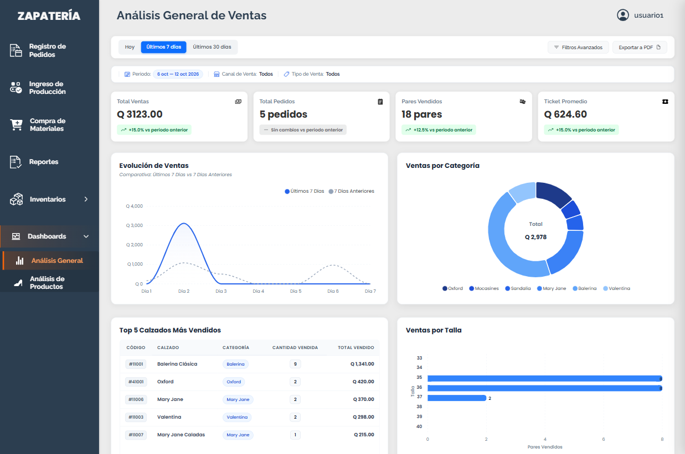
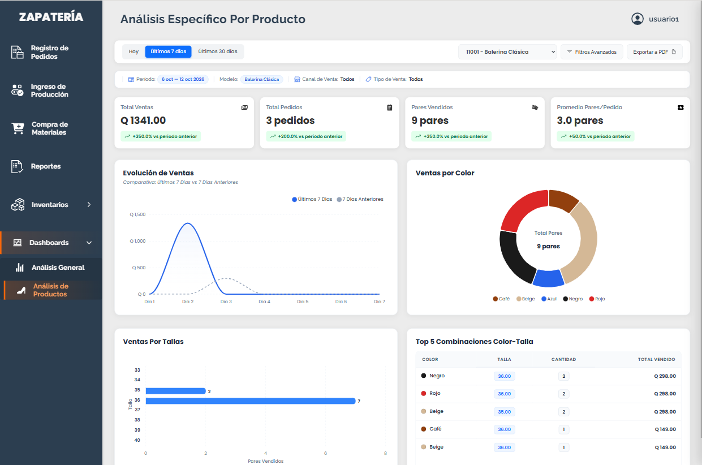

# Sistema Administrativo para Zapatería

Sistema web diseñado para gestionar las operaciones principales de una zapatería, incluyendo pedidos, producción, compras de materiales, inventarios, reportes y análisis de ventas. La plataforma centraliza la información operativa y ayuda a mejorar la trazabilidad de los procesos de fabricación y comercialización.

## Descripción general

El proyecto permite administrar de forma integral los procesos de negocio de la empresa, desde el registro de pedidos hasta la consulta de indicadores de rendimiento en ventas. Además, incorpora dashboards para analizar métricas clave y facilitar la toma de decisiones basada en datos.

## Módulos principales

### Registro de Pedidos
Gestiona el registro de pedidos mediante un formulario de múltiples pasos. Incluye datos del pedido (período, tipo y canal de venta, vendedor, fechas de pedido y entrega), productos solicitados (código, color, talla, cantidad y precio), datos del cliente (nombre, correo, teléfono, NIT, perfil) e información de envío (dirección, departamento, mensajería, costo, forma de pago). Presenta un resumen antes de confirmar el pedido.

### Producción
Administra dos secciones: **Catálogo de Calzados**, que permite registrar y gestionar modelos (código, tipo, línea, descripción, precio costo y estado activo/inactivo); y  **Historial de Producción**, que registra cada lote fabricado con fecha, código de calzado, color, talla y cantidad.

### Compra de Materiales
Registra las compras de materiales para la fabricación con información de descripción, cantidad, precio total, comprador, proveedor, fecha de compra y número de comprobante. Permite consultar y filtrar el historial de compras por descripción, proveedor, comprador y fecha.

### Inventario de Producción
Consulta las existencias de calzado producido organizadas por código, descripción, tipo, línea, color y talla, con filtros de búsqueda y paginación.

### Inventario de Materiales
Consulta el stock de materiales disponibles (código, descripción y cantidad), con búsqueda por descripción y paginación.

### Reportes
Contiene dos vistas: **Reporte de Pedidos**, que muestra el estado, fechas y datos de entrega de cada pedido con posibilidad de consultar el detalle completo y actualizar el estado; y el Reporte de Ventas, que presenta un resumen de ventas por forma de pago  con cantidades y montos por período.

### Inteligencia de Negocios
Incluye dos dashboards:
- **Análisis General**: indicadores KPI y gráficos de evolución de ventas, top 5 calzados, ventas por categoría y por talla, con filtros por período, canal de venta y tipo de venta.
- **Análisis Específico por Producto**: indicadores y gráficas detalladas por modelo (ventas anuales, por color, por talla), con filtro de modelo, período y filtros avanzados. Permite exportar el análisis a PDF.

## Tecnologías utilizadas

### Frontend
- HTML5
- CSS3
- JavaScript

### Backend
- PHP

### Base de datos
- MySQL

### Librerías y recursos
- SweetAlert2
- Ionicons
- ApexCharts

## Estructura del proyecto

- `index.html` - pantalla de inicio de sesión
- `php/vistas/` - módulos principales del sistema
- `php/configuraciones/` - lógica de negocio, inserciones, filtros y configuración
- `js/` - scripts de la interfaz y funcionalidad del sistema
- `css/` - estilos y diseño responsivo
- `capturas/` - imágenes de referencia del sistema

## Capturas del sistema

### Inicio de sesión

### Página principal

### Registro de pedidos

### Ingreso de producción

### Inventario de producción

### Compra de materiales

### Reportes

### Dashboard de Análisis General

### Dashboard de Análisis Específico Por Producto

## Nota

Este repositorio se presenta con fines de portafolio. Por motivos de privacidad y seguridad, no se incluyen la base de datos real, credenciales ni información sensible del entorno productivo.