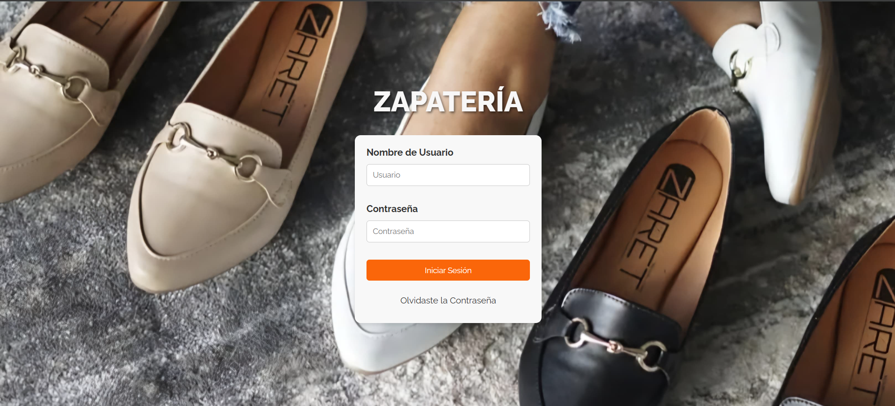
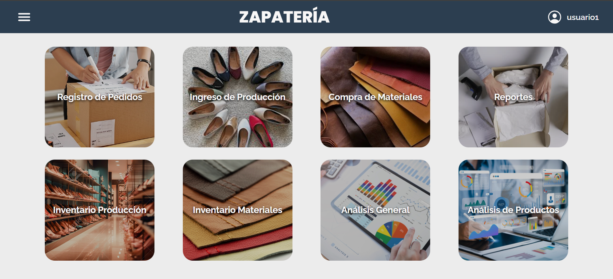
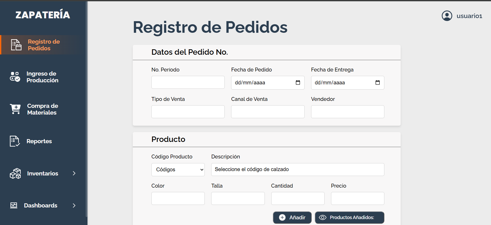
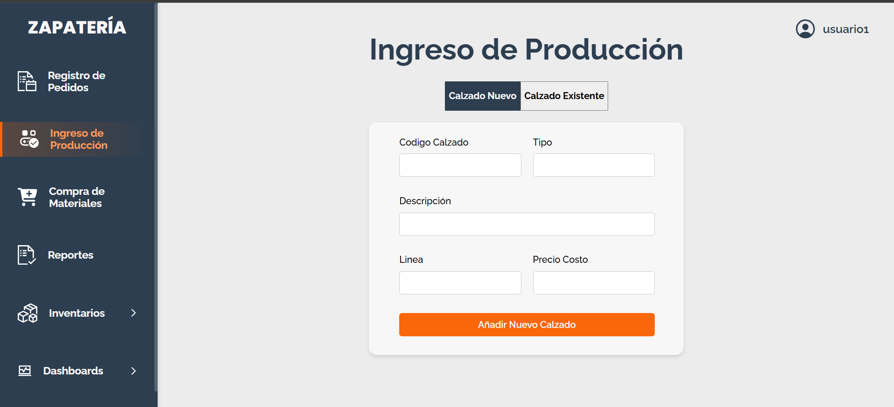
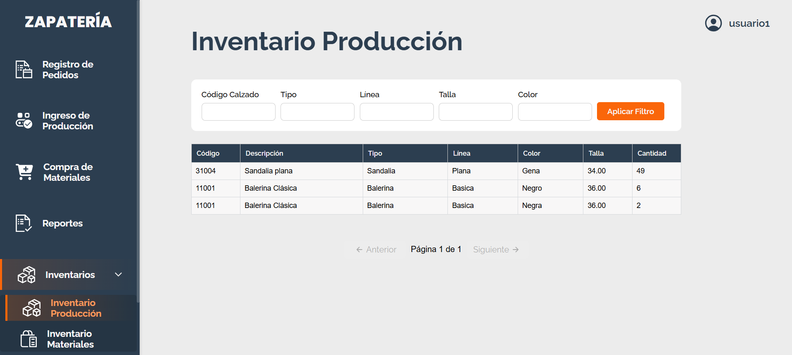
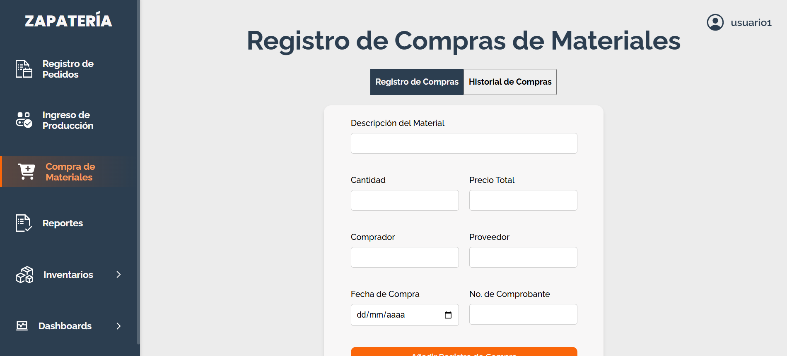
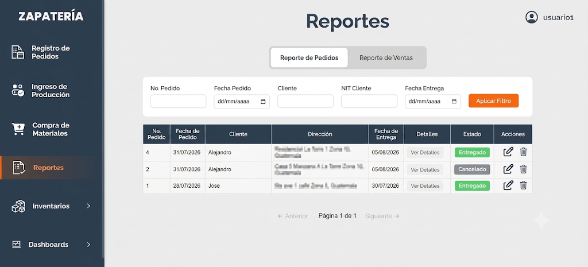

# 🏪 Sistema Administrativo Web — Zapatería

Sistema administrativo web aplicado a una zapatería, orientado a la gestión de pedidos, producción, compras, inventarios y generación de reportes. El sistema centraliza información de los principales procesos operativos y facilita el seguimiento de las actividades relacionadas con la fabricación y comercialización de calzado.

Actualmente, el proyecto se encuentra en evolución con el desarrollo de un **módulo de Inteligencia de Negocios**, orientado al análisis de ventas mediante indicadores y dashboards para facilitar la interpretación de la información y apoyar la toma de decisiones.

---

## 🚀 Características principales

El sistema integra diferentes módulos para gestionar los procesos administrativos y operativos de la zapatería:

### 📦 Registro de Pedidos

Permite registrar y gestionar los pedidos realizados por los clientes, incluyendo información del pedido, productos solicitados, datos del cliente, tipo y canal de venta, información de envío y forma de pago.

### 🏭 Ingreso de Producción

Permite registrar la producción de calzado, incluyendo el ingreso de nuevos productos y el registro de cantidades fabricadas para productos existentes, especificando características como color, talla y cantidad.

### 🛒 Compra de Materiales

Permite registrar las compras de materiales utilizados en la fabricación de calzado, almacenando información relacionada con cantidades, costos, proveedores, compradores y comprobantes. También permite consultar el historial de compras mediante diferentes filtros.

### 📦 Inventario de Producción

Permite consultar y controlar las existencias de calzado producido, organizadas por código, modelo, línea, color y talla, facilitando la búsqueda y consulta de los productos disponibles.

### 🧰 Inventario de Materiales

Permite controlar las existencias de los materiales utilizados en la producción, proporcionando información sobre las cantidades disponibles y herramientas para localizar los materiales registrados.

### 📊 Reportes

Incluye reportes de pedidos y ventas que permiten consultar información mediante diferentes filtros y visualizar datos como estados de pedidos, formas de pago, cantidades y montos de venta.

### 📈 Inteligencia de Negocios

Módulo actualmente en desarrollo orientado al análisis de las ventas mediante indicadores y dashboards interactivos.

Incluye:

* **Análisis General:** visualización de indicadores y métricas generales sobre las ventas.
* **Análisis de Productos:** análisis de las ventas según productos, categorías y otras características para facilitar la identificación de tendencias y productos con mayor demanda.

---

## 🛠️ Tecnologías utilizadas

### Frontend

* HTML5
* CSS3
* JavaScript

### Backend

* PHP

### Base de datos

* MySQL

### Librerías

* [SweetAlert2](https://sweetalert2.github.io/) — Alertas y modales.
* [Ionicons](https://ionic.io/ionicons) — Iconografía de la interfaz.

### Herramientas

* XAMPP
* Git
* GitHub

---

## 🖥️ Capturas del sistema

### 🔐 Inicio de sesión

### 🏠 Página principal

### 📦 Registro de pedidos

### 🏭 Ingreso de producción

### 📦 Inventario de producción

### 🛒 Compra de materiales

### 📊 Reportes

### 📈 Dashboard de Inteligencia de Negocios

---

## 📌 Nota

Este repositorio presenta el proyecto con fines de portafolio. Por motivos de privacidad y seguridad, no se incluye la base de datos, información utilizada en el entorno real ni credenciales de acceso.
